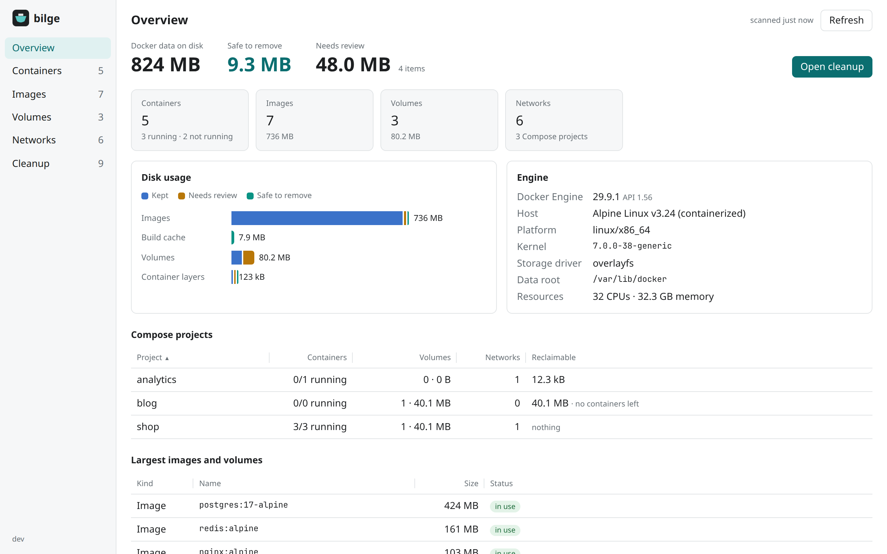
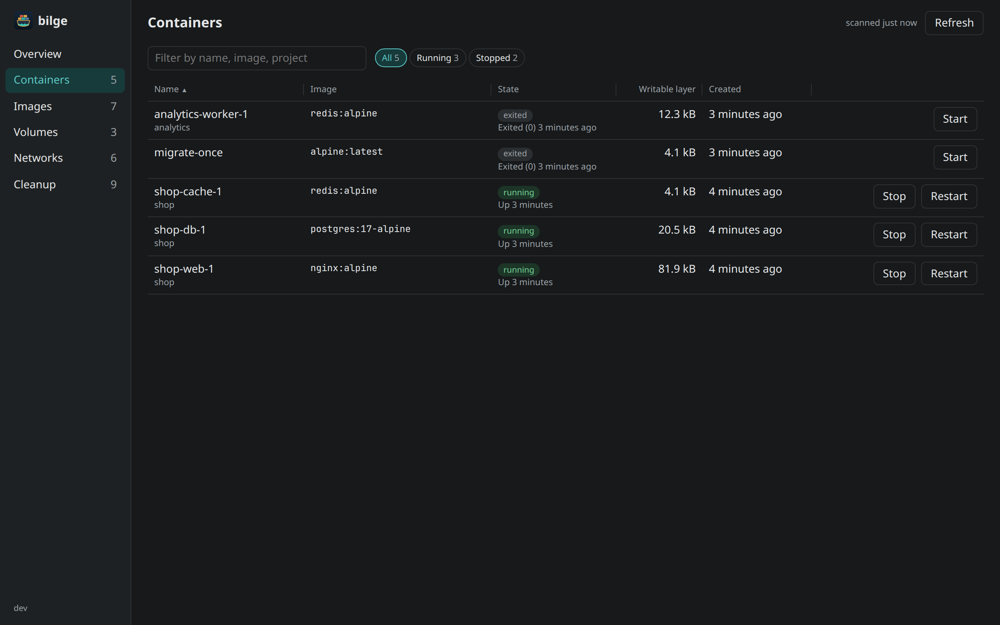
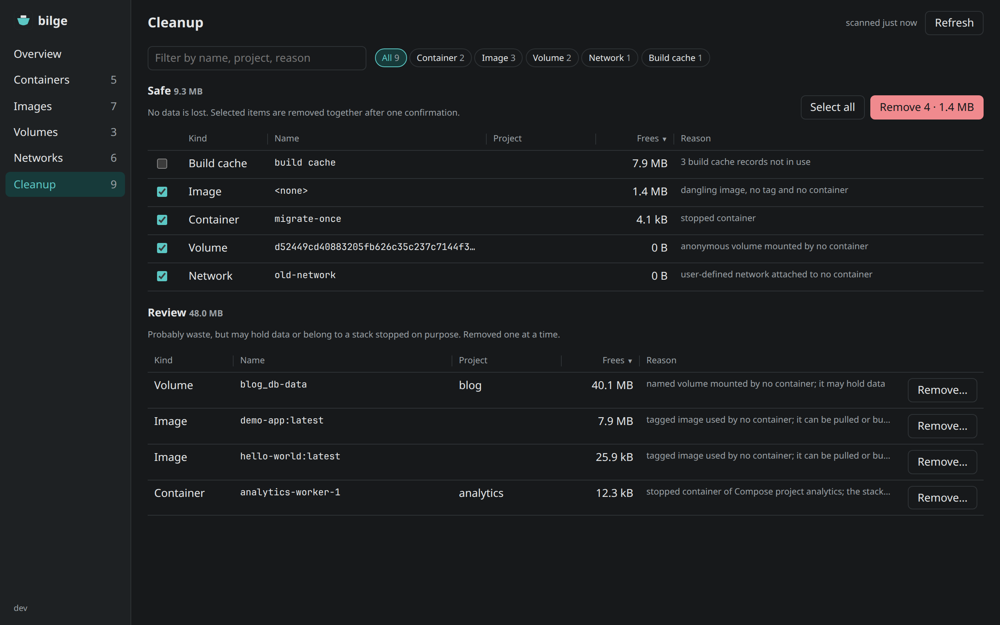
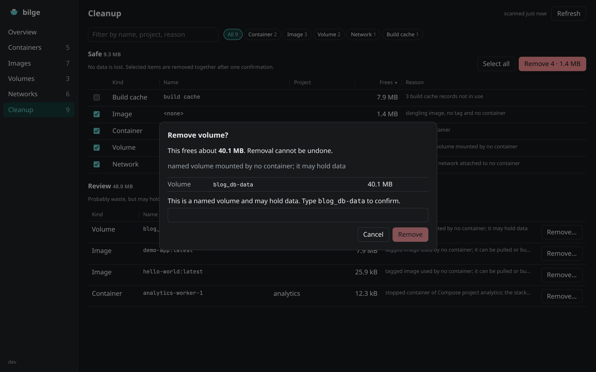

# bilge

[](https://github.com/kemalasliyuksek/bilge/actions/workflows/ci.yml)

English | [Türkçe](README.tr.md)

A simple desktop app to monitor, manage and clean up your Docker Engine.

<picture>
  <source media="(prefers-color-scheme: dark)" srcset="docs/screenshots/overview-dark.png">
  
</picture>

bilge shows what your engine holds and what it costs on disk, lets you start
and stop containers, and removes what is actually waste without touching what
you still need. It runs on Linux, macOS and Windows and talks to the local
engine, or to the one named by `DOCKER_HOST`.

> Status: early development (v0.1.0). Try it on an engine you can afford to lose things
> on before trusting it with one you cannot.

## What it does

**Monitor.** The overview splits Docker's disk usage into what stays, what
needs a look and what can go. It lists your Compose projects, including the
ones whose containers are gone but whose volumes and images are still there,
and the largest images and volumes. Containers, images, volumes and networks
each have their own list with search, status filters and sortable, resizable
columns.

**Manage.** Start, stop and restart containers from the list.



**Clean up.** `docker system prune` and most "prune" buttons treat everything
that is not referenced right now as reclaimable. That includes the database
volume of a Compose stack you stopped for the weekend. bilge sorts candidates
into two groups instead:

- **Safe**: dangling images, anonymous volumes, stopped standalone containers,
  empty networks and unused build cache. Removed together after one
  confirmation. The build cache is left unselected, since removing it makes
  the next builds start from scratch.
- **Review**: named volumes, tagged images and stopped containers that belong
  to a Compose project. Shown with the reason and removed one at a time. A
  named volume must be confirmed by typing its name.



Anything in use, or labelled `bilge.keep=true`, is never offered for removal.
Right before removing, bilge scans the engine again and skips every item that
changed since you looked, such as a volume a container has just mounted. The
full rules are in [docs/design.md](docs/design.md).



## Download

Get the [latest release](https://github.com/kemalasliyuksek/bilge/releases/latest).
Each release has builds for Linux, macOS (universal) and Windows and a
`SHA256SUMS` file; check a download with `sha256sum -c SHA256SUMS
--ignore-missing`. Changes are listed in [CHANGELOG.md](CHANGELOG.md).

- **Linux**: extract the `.tar.gz` and run `./bilge`. It needs WebKitGTK 4.1
  (`libwebkit2gtk-4.1-0` on Debian and Ubuntu).
- **macOS**: unzip and move `bilge.app` to Applications. The app is not signed
  yet, so the first time right-click it and choose Open.
- **Windows**: unzip and run `bilge.exe`. SmartScreen may warn because the
  binary is not signed yet.

## Development

Requirements:

- Go 1.25+
- Node.js 24 and pnpm
- [Wails v2](https://wails.io) CLI: `go install github.com/wailsapp/wails/v2/cmd/wails@latest`
- [just](https://just.systems) and [golangci-lint](https://golangci-lint.run) v2
- Linux: `libgtk-3-dev` and `libwebkit2gtk-4.1-dev`

If you use [mise](https://mise.jdx.dev), `mise install` sets up the pinned tool
versions from `mise.toml`.

```sh
cd frontend && pnpm install && cd ..
just dev      # run with hot reload
just check    # format check, lint, typecheck, tests
just build    # production binary in build/bin
```

## How it is made

bilge is designed and maintained by Kemal Aslıyüksek. Most of the code is
written with Claude Code, an AI coding agent, working from the design in
[docs/design.md](docs/design.md). Kemal sets the direction, makes the decisions
and reviews every change. Changes must pass the quality gate, and behavior
changes come with tests.

## License

[MIT](LICENSE)

Docker is a trademark of Docker, Inc. bilge is an independent project and is
not affiliated with or endorsed by Docker, Inc.
